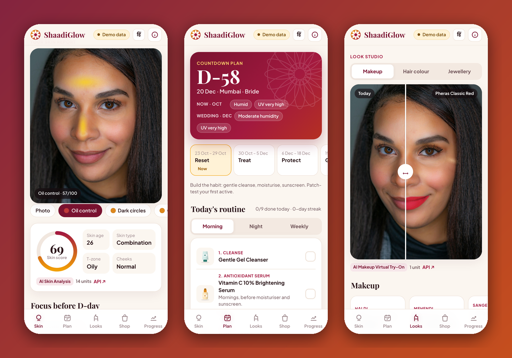
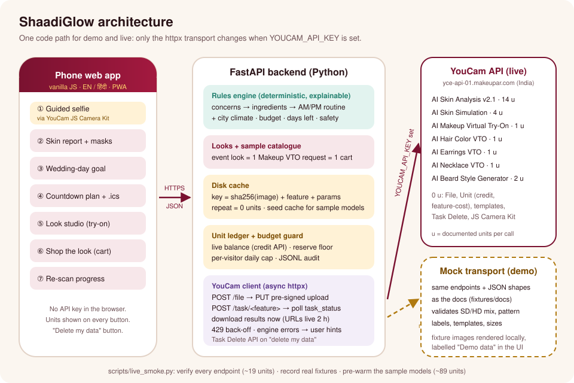

# ShaadiGlow · शादी ग्लो

**Wedding-ready skin, planned to the day.** ShaadiGlow is a mobile web app for India's wedding season. A selfie
goes through **YouCam AI Skin Analysis**; the result becomes a **countdown skin-prep plan** for your wedding date,
city climate and budget; you **try every event look** (makeup, hair colour, jewellery, beard) with YouCam's
virtual try-on APIs; and everything you tried lands in **one cart**. Re-scans track progress honestly.



| | |
|---|---|
| **Demo video** | `demo/demo.mp4` (2:30, narrated; YouTube link goes in SUBMISSION.md) |
| **Live app** | `https://<your-service>.onrender.com` (see [DEPLOY.md](DEPLOY.md)) |
| **Target device** | Phone browser (390 px wide), installable as a PWA. Desktop shows the same phone layout. |
| **YouCam APIs** | AI Skin Analysis v2.1 · AI Skin Simulation · AI Makeup Virtual Try-On · AI Hair Color · AI Earrings · AI Necklace · AI Beard Style Generator · File, Unit and Task Management APIs · JS Camera Kit |

## The problem

India's wedding economy runs in short, intense seasons. CAIT projected **46 lakh weddings worth ₹6.5 lakh crore**
in the 1 Nov–14 Dec 2025 season alone, with jewellery about 15% and apparel about 10% of spend
([CAIT press release, 30 Oct 2025](https://cait.in//images/press-release/pdf_1762754341.pdf)). Every one of those
weddings has a bride, a groom and dozens of guests who want to look their best on camera, and the usual pattern is:

1. **Skin prep starts too late** and without a plan. Actives such as retinol need 8+ weeks; many people start them
   in the final fortnight.
2. **People experiment in the last week** (a new serum, an unfamiliar facial, threading the day before) and walk
   into the wedding with irritation or a breakout.
3. **Looks are bought blind**: lipstick shades, hair colour and jewellery are chosen from flat product photos
   across many apps.

ShaadiGlow turns one AI skin scan into a dated plan, shows the goal and the looks on your own face first, and puts
the exact products in one basket.

## What it does

| Step | What the shopper sees | YouCam API | Units |
|---|---|---|---|
| 1. Capture | Guided selfie (light, angle, distance checks) or upload with an on-screen oval crop | JS Camera Kit, File API | 0 |
| 2. Skin report | Score, skin age, T-zone vs cheeks skin type, 11 scored concerns, tap-to-see AI masks | AI Skin Analysis v2.1 (12 SD concerns, JSON, raw masks) | 14 |
| 3. Wedding-day goal | Before/after slider of her top concerns, labelled "a preview, not a promise" | AI Skin Simulation | 4 |
| 4. Countdown plan | Phases (Reset → Treat → Protect → Glow), AM/PM routine with a "why" for every step, milestones, `.ics` export | (rules engine) | 0 |
| 5. Look studio | One complete event look per call (Haldi, Mehendi, Sangeet, Pheras, Reception), shade-matched foundation | AI Makeup Virtual Try-On | 1 per look |
| | Hair colour shades | AI Hair Color Virtual Try-On | 1 |
| | Jhumkas, chandbalis, studs; kundan choker, temple haar, pearl layers | AI Earrings / AI Necklace Virtual Try-On | 1 |
| | Groom beard styles (live template list) | AI Beard Style Generator | 2 |
| 6. Shop the look | One cart: routine + look + jewellery, each item tagged with the concern it treats, budget meter, WhatsApp share | sample catalogue | 0 |
| 7. Progress | Quick re-scan of the 4 tracked concerns; deltas inside ±3 points are "steady" | AI Skin Analysis (4 concerns) | 9 |
| Privacy | "Delete my photos & results" also deletes every YouCam task and file | Task Management API | 0 |

English and Hindi (हिंदी) throughout, including the plan's explanations.

### The rules engine (no LLM, fully explainable)

`app/engine/planner.py` is deterministic: the same scan and inputs always give the same plan, and every step
carries the ids of the rules that put it there (`R-FOCUS`, `R-HUMID`, `R-TIME-SKIP` …), shown under **Why?**.

- **Concerns → ingredients.** The 3–4 weakest scores (ranked by YouCam's `raw_score`) are covered greedily by
  ingredients with known targets (niacinamide, salicylic acid, azelaic acid, vitamin C, lactic acid, retinol,
  peptides…), limited by budget tier (2/3/4 actives).
- **Time.** Each active has a minimum runway (retinol 60 days, vitamin C 28, salicylic 21…) and a stop date (retinol
  D-7, acids D-5). Plans change shape with the runway: *full* (≥60 days), *standard*, *gentle* (14–29) and
  *rescue* (<14: no new actives at all). New actives are introduced one at a time after a 48 h patch test, and
  nothing new is introduced in the last 14 days.
- **Climate.** 16 wedding cities with month-by-month humidity, temperature and UV bands pick gel vs cream textures
  and sunscreen, add a double cleanse in smog season, and schedule a **season switch** when the city turns dry
  before the wedding (e.g. Delhi in December).
- **Safety and rituals.** Pregnancy/breastfeeding removes retinoids and leave-on acids; sensitive skin removes
  exfoliants; mehendi adds the PPD "black henna" warning; haldi adds after-care; benzoyl peroxide carries a
  "bleaches fabric — keep it off your lehenga" note.
- **Budget.** ₹ / ₹₹ / ₹₹₹ caps; optional extras drop first if the basket runs over.

## Architecture



- **Backend**: FastAPI (`app/main.py`) with an async YouCam client (`app/youcam/client.py`) that implements the
  documented flow: `POST /s2s/v2.0/file` → `PUT` to the pre-signed URL → `POST /s2s/v2.x/task/<feature>` → poll
  `task_status` → download results immediately (result URLs expire after 2 hours) → store.
- **Disk cache** (`app/youcam/cache.py`): key = `sha256(image bytes) + feature + params`. A repeat costs 0 units.
  `cache_seed/` is a read-only cache shipped in the repo, so the sample models are free even on a fresh deploy.
- **Unit ledger + budget guard** (`app/youcam/ledger.py`): every live call is authorised first against the real
  balance (`GET /s2s/v1.0/client/credit`), a reserve floor and a per-visitor daily cap.
- **Frontend**: vanilla JS modules + hand-written CSS (`app/static/`), no build step, self-hosted fonts, PWA manifest.

## Mock vs live

There is no key in this repo. One environment variable switches modes; no code changes.

| | Demo mode (default) | Live mode |
|---|---|---|
| Trigger | `YOUCAM_API_KEY` unset | `YOUCAM_API_KEY` set (Render secret) |
| Transport | `app/youcam/mocktransport.py`: same endpoints, same JSON shapes as the docs (`fixtures/docs/`), same validation (SD/HD mixing, pattern labels, template ids, image sizes), pre-signed upload/download URLs | real `https://yce-api-01.makeupar.com` (India, default) or `yce-api-01.perfectcorp.com` (`YOUCAM_REGION=global`); `YOUCAM_BASE_URL` overrides |
| Images | fixture images rendered locally from licensed sample photos, labelled **Demo data** in the UI | YouCam results |
| Units | simulated ledger | real balance, reserve and per-visitor cap |

`scripts/live_smoke.py` (needs the key) verifies every endpoint once with the cheapest legal request (~19 units),
records the real responses into `fixtures/recorded/`, prints "documented vs actually charged" units per feature,
and with `--prewarm core` caches the sample-model journeys into `cache_seed/live/` (~89 units).

## Unit budget (1,000 free units)

| Action | Units |
|---|---|
| Full skin scan (12 SD concerns) | 14 |
| Quick re-scan (4 tracked concerns) | 9 |
| Wedding-day goal (Skin Simulation, ≤4 concerns) | 4 |
| One event look (Makeup VTO, all effects in one call) | 1 |
| Hair colour / earrings / necklace | 1 each |
| Beard style | 2 |
| File upload, polling, templates, unit balance, task delete | 0 |

A full bride journey (scan, goal, 5 looks, 2 hair colours, 2 jewellery pieces, 1 re-scan) is about **36 units**; a
repeat of anything is 0. One-time costs: live smoke ~19, pre-warm ~89, noise check 18. That leaves roughly 850 units
for judges' own photos, protected by a 60-unit reserve and a 60-unit-per-visitor daily cap.

Design choices that save units: 12 concerns instead of 16 (14-unit tier, skipping eyelid droop, firmness and tear
trough, which no cream fixes before a wedding); a whole look in one Makeup VTO call; re-scans on 4 concerns (9 units
instead of 14); file ids reused for a week; results cached forever.

## Run it locally

```bash
python3 -m venv .venv && .venv/bin/pip install -r requirements-dev.txt
.venv/bin/python -m playwright install chromium        # only for the e2e test / screenshots / video
.venv/bin/uvicorn app.main:app --reload                # http://127.0.0.1:8000 (demo mode)

export YOUCAM_API_KEY=...                               # from yce.makeupar.com > API Keys (never commit it)
.venv/bin/python scripts/live_smoke.py --dry-run        # see what it would spend
.venv/bin/python scripts/live_smoke.py                  # verify all endpoints (~19 units)
.venv/bin/python scripts/live_smoke.py --prewarm core   # cache the sample journeys (~89 units), then commit cache_seed/
.venv/bin/uvicorn app.main:app                          # live mode
```

## Tests

```bash
.venv/bin/python -m pytest -q
```

81 tests: the mock is checked against the documented response shapes and error messages; the real client runs the
full upload → task → poll → download flow against it; cache hits never reach the API; the budget guard; mode
switching; the planner's timing, climate, safety and budget rules; every look validated against YouCam's official
makeup pattern catalogues; the HTTP API including upload hardening and data deletion; proof that the pre-warm fills
exactly the cache keys the app uses; and a **Playwright smoke test** of the main journey on a phone viewport.

## Project layout

```
app/main.py             FastAPI routes          app/services.py      cache → guard → YouCam → cache
app/youcam/             client, features+costs, cache, ledger, mock transport, makeup pattern catalogue
app/engine/             concerns, knowledge (ingredients + rules), climate, catalogue, looks, planner, progress, ics
app/mock/               mock engine + renderers (demo mode only) + sample personas
app/static/             index.html, css/, js/ (app, i18n, art), personas/, jewellery/, fonts/
scripts/                live_smoke.py, make_screenshots.py, record_demo.py
tools/                  prepare_personas.py (MediaPipe, offline), make_jewellery.py
fixtures/docs/          YouCam documentation examples (contract tests)    fixtures/recorded/  live responses
tests/                  unit, contract, API and Playwright tests
```

## Privacy and honesty

- Consent is required before any photo leaves the phone; "Delete my photos & results" removes our copies and calls
  YouCam's Task Delete API for every task the profile created. No accounts, no names, no tracking.
- The API key lives only in the server environment.
- Skin guidance is cosmetic, not medical, and the app says so. The skin-simulation goal is labelled as a preview.
- The store is a **sample**: fictional, unbranded products with illustrative prices. Jewellery artwork is original.

## Credits and licence

MIT licence (see `LICENSE`). Sample photos are Unsplash-licensed (see [ASSETS.md](ASSETS.md)); fonts are SIL OFL.
YouCam, YouCam API and Perfect Corp. are trademarks of Perfect Mobile Corp.; this project is an independent
hackathon entry built on their public API.
